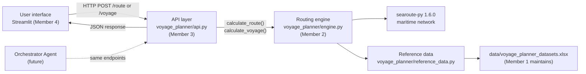

# T04 Application Architecture and Data Contract

**Owner:** Member 3  **Reviewers:** Member 2 (routing), Member 4 (user interface)  **Status:** Draft for team agreement  **Date:** 28 Oct 2026

The request and response formats follow the course's `API_SPECIFICATION.md`. This document explains how the parts fit together and records decisions that the specification leaves open.

## 1. Components



**Rule:** each layer only talks to the layer next to it. The user interface never imports `searoute`; the engine never knows about HTTP; nobody reads the workbook except `reference_data.py`.

| Layer | File | Owner | Responsible for | Must not |
| --- | --- | --- | --- | --- |
| Reference data | `reference_data.py`, `data/voyage_planner_datasets.xlsx` | Member 1 (content), Member 3 (loader) | Port and passage lookup, aliases, approach points | Contain routing logic |
| Data contract | `schemas.py` | Member 3 | Request and response models shared by every layer | Contain calculations |
| Routing engine | `engine.py` | Member 2 | Resolve endpoints, call searoute, waypoints, multi-leg totals, passages, errors | Know about HTTP or the user interface |
| API | `api.py` | Member 3 | Endpoints, convert errors to the specification's error format | Calculate distances itself |
| User interface | `app.py` (to be built) | Member 4 | Inputs, map, tables, export | Call `searoute` directly |

## 2. Endpoints

| Method | Path | Purpose | Specification |
| --- | --- | --- | --- |
| GET | `/health` | Service running, calculation version | Required |
| POST | `/route` | One origin to one destination, optional waypoints | Required |
| POST | `/voyage` | Multi-leg voyage; each leg plus total | Required |
| GET | `/ports` | Port list for the user interface drop-down | Added |
| GET | `/passages` | Passage IDs accepted by the constraint fields | Added |
| GET | `/docs` | Interactive documentation, generated automatically | Added |
| POST | `/compare` | Alternative route comparison | Planned (T23) |

## 3. Route request and response

Request — origin and destination are each **either** a port ID **or** coordinates, never both:

```json
{
  "origin_port_id": "SGSIN",
  "destination_coordinates": null,
  "destination_port_id": "NLRTM",
  "required_passage": null,
  "excluded_passage": null,
  "waypoints": [],
  "calculation_version": "0.1.0"
}
```

`origin_port_id` and `destination_port_id` also accept a port name, UN/LOCODE or alias from the Port Reference (for example `"Bombay"` finds `INBOM`).

Response fields: `route_id`, `status` (`"success"`), `distance_nm`, `origin`, `destination` (each with `port_id`, `port_name`, `latitude`, `longitude`), `routing_points`, `passages_used`, `route_geometry`, `assumptions`, `warnings`, `calculation_version`.

## 4. Voyage request and response

```json
{
  "legs": [
    {"origin_port_id": "SGSIN", "destination_port_id": "HKHKG"},
    {"origin_port_id": "HKHKG", "destination_port_id": "LKCMB"},
    {"origin_port_id": "LKCMB", "destination_port_id": "ZADUR"}
  ]
}
```

Each leg accepts every field of a route request. The response lists each leg (`leg_number`, `origin_port_id`, `destination_port_id`, `origin`, `destination`, `distance_nm`, `passages_used`, `route_geometry`) and `total_distance_nm`. If one leg does not start where the previous one ended, the voyage is still calculated and a warning is added.

## 5. Errors

Body: `{"status": "error", "error_code": "...", "message": "...", "warnings": []}`

| HTTP status | `error_code` | When |
| --- | --- | --- |
| 404 | `PORT_NOT_FOUND` | Port ID, name or alias not in the Port Reference, or port not active |
| 400 | `MISSING_ORIGIN` | No origin port and no origin coordinates |
| 400 | `MISSING_DESTINATION` | No destination port and no destination coordinates |
| 400 | `INVALID_COORDINATES` | Latitude outside −90 to 90 or longitude outside −180 to 180 |
| 400 | `INVALID_PASSAGE` | Passage not in the Passage Reference |
| 400 | `INVALID_REQUEST` | Wrong data types, empty voyage, or both a port and coordinates for one end |
| 422 | `ROUTE_NOT_FOUND` | searoute finds no path |
| 422 | `ROUTE_NOT_FOUND` | An excluded passage cuts off every path (for example Singapore to Suez port with SUEZ excluded) |
| 501 | `PASSAGE_NOT_SUPPORTED` | A `required_passage` is given, or a cape is excluded (added code; removed once tasks T18–T19 are done) |

For a voyage, the message names the failing leg, for example `"Leg 2: The supplied destination port ID was not found: XXNOPE."`

## 6. Conventions

- Distances in nautical miles, rounded to 2 decimal places.
- Geometry is GeoJSON; coordinates are `[longitude, latitude]`. Responses' `latitude` and `longitude` fields are named, so order there is not an issue.
- The same request always returns the same `route_id` / `voyage_id` (a hash of the request, calculation version and searoute version).
- Every response warns "Academic estimate; not for navigation."
- `calculation_version` is raised whenever the engine or reference data changes a result.

## 7. Decisions for the team

1. **Excluded passages: supported only where the network can enforce them.** In searoute's network, Panama, Suez, Gibraltar and Malacca are each a single connection, so excluding one removes it before the route is searched. `excluded_passage` is therefore accepted for `PANAMA`, `SUEZ`, `GIBRALTAR` and `MALACCA`. As an independent check, the engine rejects the result if `passages_used` still contains the excluded passage. Capes are not network connections, so excluding `CAPE_HORN` or `CAPE_GOOD_HOPE` returns `PASSAGE_NOT_SUPPORTED`.
   **Required passages are refused, not ignored.** searoute has no "must pass through" option, and adding a waypoint near a canal does not prove the route transits it. Until tasks T18–T19 are done, `required_passage` returns `PASSAGE_NOT_SUPPORTED`, so a route that ignores "via Panama" can never look correct.
   **The Northwest Passage is always blocked.** Every request keeps searoute's default Arctic block. Removing it shortens 11 of the 406 port pairs unrealistically (for example Rotterdam to Shanghai from 10,575.9 to 8,358.3 nautical miles).
2. **Excluding a passage is not the same as going round a cape.** searoute can block named passages (`panama`, `suez`, `gibraltar`, `malacca` and others). Blocking Panama for Houston to Tocopilla gave 9,773.24 nautical miles through the `chili` passage (Chilean channels), not the 9,973 nautical mile Cape Horn baseline in BM_006. Member 2 should check how to force a true Cape Horn route.
3. **Endpoint snapping.** searoute connects each endpoint to its nearest network point, so the line does not start exactly at the port. Agree with Members 1 and 2 whether to warn when that gap is large.
4. **Reference data file.** The engine reads `data/voyage_planner_datasets.xlsx`. When Member 1 freezes a cleaned version, set the `VOYAGE_DATA_FILE` environment variable to its path; no code changes needed.
5. **Engine ownership.** `engine.py` is working code so the API and tests can run, but Member 2 owns it. Keep the names and inputs of `calculate_route` and `calculate_voyage`.
